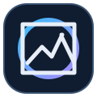

<div align="center">


[](LICENSE) [](https://github.com/CyberLoop-dev/image-resample-lab) [](https://github.com/CyberLoop-dev/image-resample-lab/stargazers) [](https://github.com/CyberLoop-dev/image-resample-lab/commits/main)



</div>

## 🧭 Overview

Load an image from your device and compare nearest-neighbor scaling with the browser canvas smoothing modes. The selected image stays in the page; no file is uploaded or stored by the app.

## ✨ Features

- ✨ Load a local image with the file picker.
- ✨ Compare nearest-neighbor, low, medium, and high smoothing.
- ✨ Adjust output scale and inspect resulting dimensions.
- ✨ Keep image processing inside the browser canvas.

## 🎬 Demo

Run the app locally and explore the controls with sample or local input. No hosted demo is claimed; files are processed in your browser and are not uploaded.

## 🚀 Quick Start

```bash
npm start
```

Open **http://127.0.0.1:4173**.

## 🧰 Tech Stack

- 🟦 Node.js built-in HTTP server
- 🌐 Browser JavaScript, HTML, CSS, and native browser APIs
- 📦 No third-party runtime dependencies

## 🗂️ Folder Structure

```text
image-resample-lab/
├── assets/mark.svg
├── public/
│   ├── app.js
│   ├── index.html
│   └── styles.css
├── .gitignore
├── LICENSE
├── package.json
├── README.md
└── server.js
```

## 🛣️ Roadmap

- [ ] Add side-by-side pixel zoom.
- [ ] Add PNG export for the resampled result.

## 🤝 Contributing

Issues and pull requests are welcome. Keep changes focused, document behavior, and avoid unnecessary dependencies.

## 📄 License

Released under the [MIT License](LICENSE).

<div align="center">


</div>
